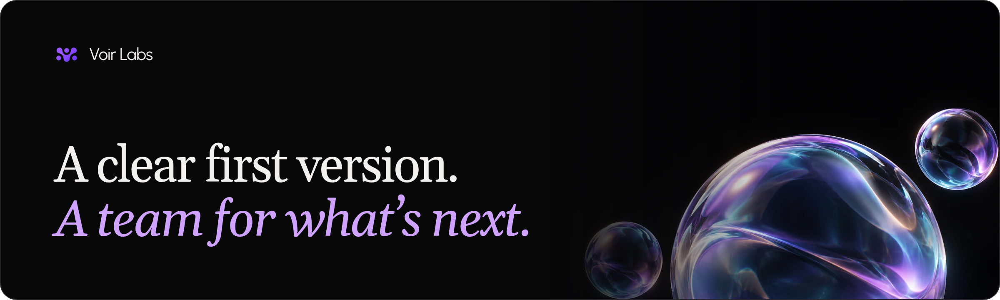
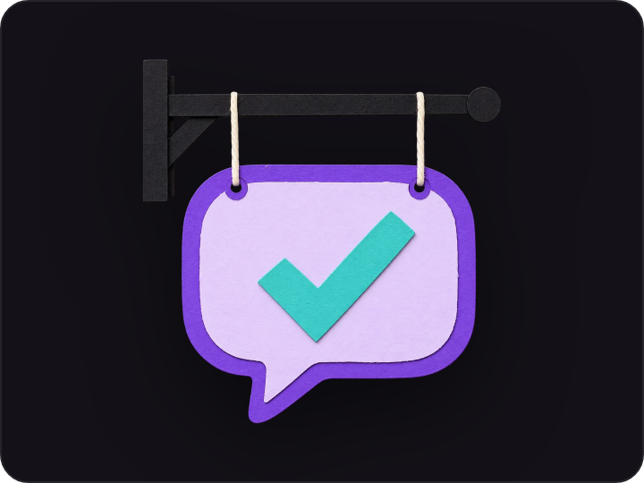
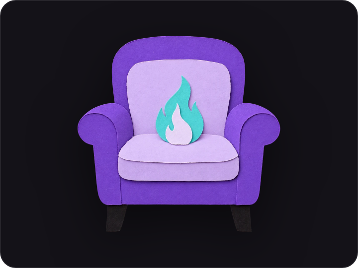
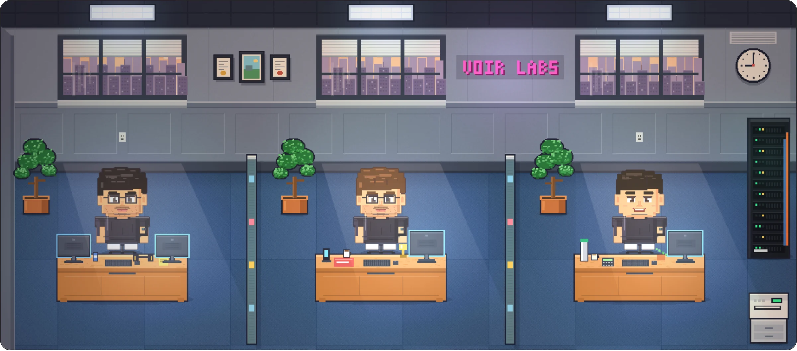

<picture></picture>

We turn ideas into websites, apps and AI products. Thoughtful design, serious engineering and a team that cares. Start with one useful release, then build from there.

[voirlabs.io](https://www.voirlabs.io) · [Book a call](https://calendly.com/voirlabs/30min) · [LinkedIn](https://www.linkedin.com/company/voirlabsofficial) · [Instagram](https://www.instagram.com/voir.labs/) · [X](https://x.com/voir_labs)

 

### <picture></picture> What we do

<table>
  <tr>
    <td width="50%" valign="top"><b>AI &amp; automation</b> Less repetitive work, more useful conversations. AI agents, voice experiences and connected workflows, with human oversight where it matters.</td>
    <td width="50%" valign="top"><b>Web design &amp; development</b> A website that makes your business clear and gives customers an obvious next step, from a focused business site to a store or customer portal.</td>
  </tr>
  <tr>
    <td valign="top"><b>Mobile apps</b> The core experience as a practical app: the user journey, the screens, and development scoped around the first useful release.</td>
    <td valign="top"><b>Custom software &amp; SaaS</b> Software around how your business actually works. Internal tools, customer-facing products and dashboards that connect the data and decisions that matter.</td>
  </tr>
  <tr>
    <td valign="top"><b>Web3 &amp; blockchain</b> Deep engineering for on-chain products: protocols, trading tools and analytics across EVM, Solana and Starknet.</td>
    <td valign="top"><b>Not sure yet?</b> You don't need a technical brief. Bring the business problem, the rough idea or the system you've outgrown, and we'll help shape the right first step.</td>
  </tr>
</table>

### <picture></picture> The way we work

<table>
  <tr>
    <td width="33%" valign="top">01 <b>Find the useful first version</b> What matters now, what can wait, and what needs testing before a bigger commitment.</td>
    <td width="33%" valign="top">02 <b>Make progress you can see</b> An agreed scope and review rhythm, working designs and software, and honest conversations when something needs to change.</td>
    <td width="33%" valign="top">03 <b>Choose what comes next</b> Launch with a clear handover, then add ongoing care or keep building as the product grows. Each is a separate decision.</td>
  </tr>
</table>

We choose the stack around your project, your existing systems and what your team can maintain: OpenAI, ElevenLabs, LangChain and n8n for AI; React, Next.js, Node.js and PostgreSQL for applications; Solidity, Rust, Anchor and Cairo on-chain.

### <picture></picture> From the studio

Things we build in the open. All MIT licensed.

<table>
  <tr>
    <td width="33%" valign="top">
      <picture></picture> 
      <a href="https://github.com/voirlabs/bluetick"><b>Bluetick</b></a> 
      AI agents for WhatsApp, defined in code
    </td>
    <td width="33%" valign="top">
      <picture></picture> 
      <a href="https://github.com/voirlabs/echo"><b>Echo</b></a> 
      The AI you already use, writing in your own voice
    </td>
    <td width="33%" valign="top">
      <picture></picture> 
      <a href="https://github.com/voirlabs/hotseat"><b>Hotseat</b></a> 
      Practice pitches against AI personas who push back
    </td>
  </tr>
</table>

### <picture></picture> Just for fun

<picture></picture>

**[Inside Voir Labs](https://inside.voirlabs.io)** is a made-up 16-bit sitcom about three founders running an AI studio: client requests, demos that break and the model bill. AI agents write a new short episode every weeknight, and it airs Monday to Friday.

 

### <picture></picture> What are you thinking about?

An idea on a napkin. A business ready for more. A product that needs a better team. [Book a 30-minute call](https://calendly.com/voirlabs/30min) or write to [contact@voirlabs.io](mailto:contact@voirlabs.io).
